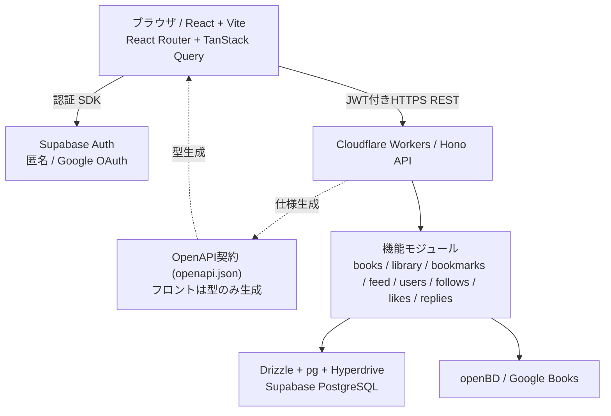
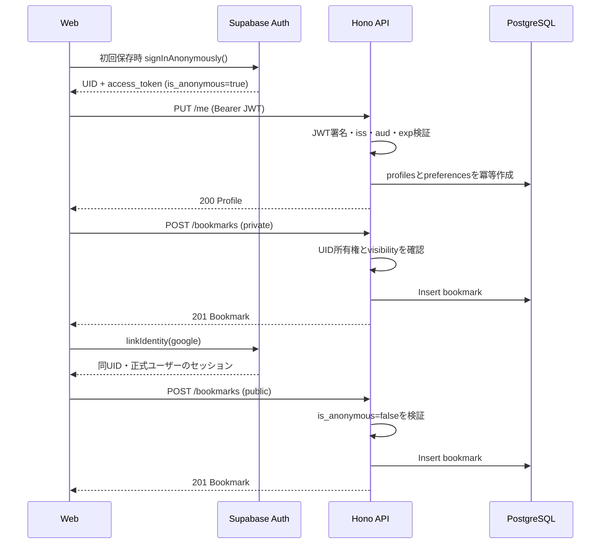

# アーキテクチャ設計書 — 技術選定と責務分離

> v0.1 / 2026-10-31。2人開発で「フロントエンドを限りなく独立・単純にする」ことを優先する。

## 1. 結論

**単一のHono APIをモジュール単位で分割するモジュラーモノリス** + **必要な部分だけRoute / Service / Repository** の構成を採用。フロントは別デプロイのReact SPAとし、**OpenAPIで生成したAPI型とHTTP通信にのみ依存**させる。



- フロント（Cloudflare Pages）とバック（Cloudflare Workers）は別のアプリとしてデプロイ。
- モノレポで管理しても、**フロントが `apps/api` の実装をimportしない**。OpenAPI JSONだけを共有。
- R2・WebSocket・Queue・RedisなどはMVPで不要。投稿画像や通知を作る時点で検討する。

## 2. 技術選定と代替比較

### 2.1 React + TypeScript + Vite

**採用理由**：モバイルファーストのSPA、フォーム、タイムライン、栞カードなどのUIを素早く構築できる。Viteは軽量な開発サーバー・単純なビルド構成で、Web側をAPIと独立して扱いやすい。

| 比較 | 今回の判断 |
|---|---|
| React + Vite | **採用**。クライアント主体のUIとAPI分離を簡素にできる |
| Next.js | SSR/Server Components/ルーティング等が便利だが、今回の構成ではフロント専用サーバーやSSRが不要。追加の設計負担を避ける |
| Astro | コンテンツ中心には優れるが、状態の多いSNS画面ではReact中心のSPAが素直 |
| Vue + Vite | 有力な代替だが、チームがReactで進める前提なら変える理由は小さい |

**注意**：SPAは公開投稿URLのSNSリンクプレビューを自動で正しく生成できるとは限らない。Xの投稿文＋URL共有は実装できるが、OG画像・カードの最適化は将来のメタ情報配信用エンドポイント等で対応する。

### 2.2 React Router

**採用理由**：タイムライン、検索、投稿、本棚、プロフィール、栞の流れをURLで表現したい。フロントはクライアントルーティングのみで十分。

- Next.jsのファイルルーティングを使わない代わりに、React Routerでルート定義を明示する。
- 共有可能なURL `/bookmarks/:id`、`/users/:userId/books/:bookId/bookmarks` を持たせる。

### 2.3 TanStack Query

**採用理由**：カーソルを使う無限スクロール、一覧キャッシュ、再取得、ミューテーション後の無効化を標準機能で扱える。

| 比較 | 判断 |
|---|---|
| TanStack Query | **採用**。`useInfiniteQuery` の `nextCursor` と相性がよい |
| SWR | シンプルなGETキャッシュに強い。今回の投稿・いいね・返信・無限スクロールではTanStack Queryを選ぶ |
| Redux等でAPI状態を自前管理 | UIの状態には使えるが、サーバー状態管理を自作すると手間が増える |

`queryKey` 例：`['feed', scope, viewerId]`、`['bookmark-flow', userId, bookId, viewerId]`、`['my-books', viewerId]`。本文表示モードは描画設定なので、切り替えたからといってAPIの再取得はしない。

### 2.4 Hono + Cloudflare Workers

**採用理由**：TypeScriptで小さなHTTP APIを構築しやすく、Cloudflareへデプロイしやすい。公開認可や複数データをまとめるタイムライン処理をAPIに集約できる。

| 比較 | 判断 |
|---|---|
| Hono + Workers | **採用**。軽量、標準的なHTTP API、Cloudflare利用と相性がよい |
| Express + Node.jsサーバー | 実績・資産が豊富だが、常時稼働するNodeサーバーの運用が増える |
| Fastify + Node.js | 高速・バリデーションが豊富で有力。今回のCloudflare環境ではHonoを優先 |
| Supabase Edge Functions / Data API直接 | バックを小さくできる一方、API境界・認可・JOIN最適化の制御をHonoに寄せる設計とは異なる |

**Workersの注意**：Node互換APIの対応状況やDBドライバを確認する。CPU/メモリ制約を意識して、重い機械学習・画像変換は後から別基盤へ切り出す。

### 2.5 OpenAPI + Zod（Hono RPCではなく）

**採用理由**：フロントエンドとバックエンドの**ソースコード上の依存を切りたい**ため。

| 比較 | OpenAPI（採用） | Hono RPC |
|---|---|---|
| API型の共有 | `openapi.json`から生成 | HonoルートのTS型を直接参照 |
| コードの独立性 | **高い**。別リポジトリにも移行しやすい | フロントがバックのTS型に依存 |
| 初期導入 | 少し設定が必要 | TypeScript同士なら簡単 |
| 他言語・ドキュメント | 仕様ファイルを広く再利用可 | Hono/TypeScriptに寄る |
| 今回 | **採用** | 見送り |

実装方法：

1. バックの `@hono/zod-openapi` でZod入出力・Routeを定義し、OpenAPI仕様を生成する。
2. 生成 `openapi.json` を契約としてコミット／CI成果物化する。
3. フロントは `openapi-typescript` でAPI型を生成、`openapi-fetch` でHTTPリクエストを送る。
4. API実装がまだなくてもMSWが同じレスポンス契約で応答する。

**設計書とOpenAPIの関係**：初期はAPI仕様に双方で合意し、バックのスキーマへ反映。合意後は生成されたOpenAPIを機械可読な正本とし、変更PRでクライアント型と設計ドキュメントを更新。手書きの型・YAMLを長期間二重管理しない。

### 2.6 Supabase PostgreSQL + Drizzle ORM

**採用理由**：本・ユーザー・栞・フォロー・いいね・返信はリレーショナルなデータ。PostgreSQLのFK・UNIQUE・JOIN・インデックスがそのまま使える。DrizzleはSQLに近い記述で、マイグレーションと型付けを管理しやすい。

| 比較 | 判断 |
|---|---|
| PostgreSQL（Supabase） | **採用**。複雑な関連・集計・必要に応じた検索拡張に対応 |
| Cloudflare D1 | SQLite系でWorkersとの接続は簡単。今回はSupabase AuthとDBを同一サービスで揃え、Postgres検索・JOINの選択肢を優先 |
| Neon PostgreSQL | DBとして有力。認証を別途組み合わせる必要があり、今回の全体構成ではSupabaseを優先 |
| Drizzle ORM | **採用**。SQLが読みやすく型付きスキーマが使える |
| Prisma | 生産性の高い代替。今回のWorkers接続とSQL主導の最適化にDrizzleを選ぶ |
| 生SQLのみ | 最小依存だが型・マイグレーション・共通スキーマの整理が増える。難所はDrizzleのsqlタグ等を使ってよい |

DBのテーブル構成・制約・インデックスは [DB設計書](database.md) 参照。

### 2.7 Supabase Auth（匿名→Google連携）

**採用理由**：匿名アカウントを先に作り、後からGoogleアカウントに連携して同じUIDの栞・本棚を継続する要件に対応する。

| 比較 | 判断 |
|---|---|
| Supabase Auth | **採用**。`signInAnonymously()`、`linkIdentity()`を利用可 |
| Firebase Auth | 匿名→外部ID連携が可能で有力。今回はPostgreSQLと同じSupabaseに寄せる |
| Better Auth／自作セッション | 柔軟だが、匿名ユーザーの昇格・OAuth・セキュリティ運用を独自に組み立てる負担が大きい |

重要：

- フロントのSupabase SDKがログイン・Google連携を実施する。通常APIはJWTを受け取りHonoが検証する。
- 匿名ユーザーは閲覧と非公開記録が可能。公開栞・フォロー・いいね・返信は不可。
- Supabase Authには匿名ユーザー用の `is_anonymous` claimがある。
- `linkIdentity()` はManual Linkingの有効化が必要。既存Googleアカウントとの競合はMVPで自動マージしない。
- 匿名状態ではセッション消失リスクがある。案内と正式登録への導線を用意する。

### 2.8 Hyperdrive（Workers → Supabase Postgres）

**採用理由**：Workersから単一リージョンのPostgreSQLへ接続する際、接続プールを利用できる。`pg` + Drizzleを使用する。

| 比較 | 判断 |
|---|---|
| Workers → Hyperdrive → PostgreSQL | **採用**。接続管理をCloudflare側に寄せる |
| WorkersからPostgres直接接続 | 可能だが接続確立のオーバーヘッド・接続数の管理を要する |
| フロントからSupabase Data API直接 | 簡単だが、今回の認可・Feed QueryをHonoに統一する方針とは異なる |

**必須注意**：Hyperdriveは読み取りSQLをキャッシュできるが、書き込みで古いSELECTキャッシュが自動無効化されるわけではない。公開範囲を変更した投稿の古いデータが返る危険があるため、**初期はクエリキャッシュを無効**にする。接続プールは利用できる。

### 2.9 書籍API（openBD / Google Books）

- Google Books：タイトルや著者／ISBNで候補検索。書誌情報に欠落がある場合も想定。
- openBD：ISBNから日本語書籍情報を補完する候補。ISBNを主なキーに利用。
- 同じISBNはバックの `books` に重複登録しない。外部候補の書誌情報はバック側で再取得してから保存。
- ISBNなし・外部APIで見つからない本は手動登録。書影・ページ数は任意。
- 画像の利用権・API利用条件・レート制限を確認。**初期は外部書影URLだけ**を扱い、R2による複製保存はしない。

### 2.10 Cloudflare Pages・MSW・Vitest

- Cloudflare Pages：Viteでビルドした静的SPAをホスト。APIのWorkersは別にデプロイ。
- MSW：フロント側のHTTP APIモック。`openapi-fetch` をそのまま利用でき、バック未完成でも画面を開発可能。インメモリのCRUD状態と403/404/空リストを模擬。
- 認証モック：外部依存を完全に断ちたいときだけ `AuthClient` インターフェースで本物／モックを切り替える。**通常は本物Supabase Auth＋MSWのAPIモックから始める**。
- Vitest：APIポリシー・バリデーション・カーソル関数などの単体テスト。重要な認可は実DBの結合テストも行う。E2Eは余裕があればPlaywright。

## 3. バックエンドの責務分離

```text
apps/api/src/
├── index.ts
├── modules/
│   ├── books/          # 書誌検索、外部APIの正規化
│   ├── library/        # 本棚、読書進捗
│   ├── bookmarks/      # CRUD・公開判定
│   ├── feed/           # 一覧最適化Query
│   ├── users/          # プロフィール
│   ├── follows/        # フォロー
│   ├── likes/          # いいね
│   ├── replies/        # 返信
│   └── preferences/    # 本文表示設定
├── middleware/         # JWT認証、登録済み認可、エラー変換
├── integrations/       # openBD, Google Books
├── db/                 # Drizzle schema・client・migrations
└── shared/             # 共通エラー・カーソル
```

- **Route**：HTTP、バリデーション、レスポンス。
- **Service**：所有者確認、匿名ユーザーの公開操作禁止、公開範囲変更、複数操作の調整。
- **Repository / Query**：Drizzleを使うDB操作。とくに`feed.query.ts`は読み取りに適したJOINと集計を使う。
- **Policy（純粋関数）**：`canPublishBookmark`, `canViewBookmark`, `shouldCollapseContent`（最後はフロント側でも利用可）。ただしフロントの表示判定とバックの権限判定は別に実装する。
- 単純CRUDは層を増やしすぎない。全モジュールに抽象クラス・インターフェースを強制しない。

## 4. フロントエンドの独立性

```text
apps/web/src/
├── app/                  # Router / Providers
├── pages/                # 画面
├── features/             # feed, book-search, bookmarks, library, profile...
├── components/           # 共通UI（BookmarkCard等）
├── lib/
│   ├── api/               # openapi-fetch、生成型、fetch wrapper
│   ├── auth/              # Supabase SDK、任意モック
│   └── query-client.ts
└── mocks/                # MSW handlers / fixtures
```

- `import type { paths } from './generated/api'` のようにOpenAPI生成型を利用。**`apps/api` のTSコードはimportしない**。
- UIが使う `useFeed`, `useBookmarkFlow`, `useCreateBookmark` 等のカスタムフックの内部で`openapi-fetch` を呼ぶ。
- TanStack Queryの `queryKey` はユーザーID・scope・対象本を分離し、ログアウト時に私有キャッシュを破棄。
- 通常フィードと栞の流れは**同じBookmarkCard**で表示、並びとヘッダー・データ取得フックを変える。
- `feedContentMode` はフロントで表示に適用し、ネタバレ指定は常に初期非表示。

## 5. 認証・認可・データフロー



- JWKSによる署名確認はSupabaseプロジェクトが非対称署名キーでJWTを発行している場合の手法。署名方式・`issuer`・`audience`・失効／ユーザー停止時の対応をプロジェクト設定に合わせて設計する。信頼できないJWTのpayloadを検証前に信用しない。
- `auth.users` とアプリテーブルのユーザーIDを一致させる。
- **Hyperdrive経由のDBセッションはSupabase AuthユーザーJWTのRLS文脈を自動的に持たない。** Honoで認可し、直接Supabase Data APIを公開しない設計にする。
- DBロールは最小権限、マイグレーション用とAPI用を分ける。

## 6. タイムラインと栞の流れの高速化

1. フィードでは公開投稿を `created_at DESC, id DESC` で**まず15件に絞る**。
2. フォロー中は `follows` で対象投稿者を条件に加える（Fan-out on Read）。
3. 栞の流れは `(user_id, book_id)` → `user_books.id` → `bookmarks` の順で、**`created_at ASC, id ASC`**。ページ番号は使わない。
4. いいねと返信は対象投稿ID集合で一括集計。返信本文は投稿詳細で取得。
5. カーソルベースで15件ずつ取得。インデックス設計は [DB設計書](database.md) 参照。
6. TanStack Queryでクライアントキャッシュ。初期は無限リストの仮想化・Redis・別フィードテーブルを導入しない。

## 7. デプロイと環境

- `web`：Pages。`VITE_API_BASE_URL` と `VITE_SUPABASE_URL`、`VITE_SUPABASE_PUBLISHABLE_KEY`（公開可能なクライアントキー）を設定。
- `api`：Workers。Supabase JWT検証設定、Hyperdrive binding、外部書籍APIキー等はWorker環境変数／Secretsとして設定。DBパスワード・秘密鍵をフロントに渡さない。
- CORSは正規WebサイトとローカルWebのoriginだけ許可。APIの公開GETにもレート制限等を設ける。
- 開発用／本番用のSupabase・Cloudflare環境は可能なら分離。最初のデプロイ時点から一度は実機スマホで検証。

## 8. 公式参考資料（設計・更新時に確認）

- Hono Zod OpenAPI: https://hono.dev/examples/zod-openapi
- OpenAPI型生成／fetch: https://openapi-ts.dev/
- TanStack Query Infinite Queries: https://tanstack.com/query/latest/docs/framework/react/guides/infinite-queries
- Supabase匿名認証: https://supabase.com/docs/guides/auth/auth-anonymous
- Supabase JWT検証: https://supabase.com/docs/guides/auth/jwts
- WorkersからSupabase: https://developers.cloudflare.com/workers/databases/third-party-integrations/supabase/
- Hyperdriveキャッシュ: https://developers.cloudflare.com/hyperdrive/concepts/query-caching/
- Drizzle PostgreSQL: https://orm.drizzle.team/docs/get-started/postgresql-new
- Google Books API: https://developers.google.com/books/docs/v1/using
- openBD: https://openbd.jp/
