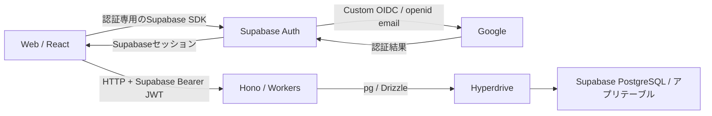
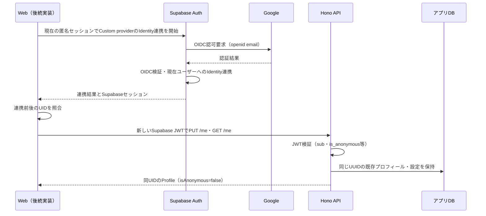

# 認証機能 Design Doc — Supabase Auth / Google Custom OIDC

状態: 設計案。Issue #18の実装・実サービス検証は未着手。

関連Issue: [#9](https://github.com/Megane14916/book-bear/issues/9)、[#18](https://github.com/Megane14916/book-bear/issues/18)

基準: main `45f0325` / 2026-11-01

## 1. 目的と決定事項

匿名で始めた読書記録を、Googleアカウントへの連携後も同じユーザーIDで利用できるようにする。Googleから要求する権限を `openid email` に限定し、Googleの氏名や画像をアプリのプロフィールへ取り込まない。

認証とデータアクセスは次の構成とする。

1. **フロントエンドには、後続タスクでSupabase SDK（`@supabase/supabase-js`）を認証用に導入する。** 匿名サインイン、Googleログイン、Identity連携、セッションの取得・更新・ログアウトに `supabase.auth` を利用する。
2. **Supabase Data APIは使用しない。** アプリデータに対する `supabase.from()`、`supabase.rpc()`、REST／GraphQLの直接呼び出しは行わず、プロフィール・本棚・栞・設定などの読み書きはHono APIへ集約する。
3. フロントはSupabase発行のaccess tokenをHono APIへBearerで送る。HonoでJWTとリソースの所有権・公開範囲を検証する。
4. HonoからDBへは、既存のHyperdrive → pg / Drizzle → Supabase PostgreSQLの経路を使う。
5. Google認証にはSupabase AuthのCustom OAuth/OIDC Providerを使い、要求スコープを `openid email` に固定する。

Supabase SDKの採用はData APIの利用を意味しない。Supabase Authは独立した認証サービスとして使用できる。[Supabase Auth公式資料](https://supabase.com/docs/guides/auth)

## 2. 今回の範囲と現在地

Issue #18はバックエンド担当の作業とする。この文書にはフロントとの接続契約も記載するが、UI・SDK導入・セッション管理の実装は後続タスクに分ける。

| 領域 | 現在 | Issue #18以降の扱い |
|---|---|---|
| Supabase JWTの検証 | Issue #9で実装済み | Custom OIDC由来のセッションでも成立することを検証 |
| プロフィール・表示設定API | 実装済み | UID維持、既定値、既存値の保持、非公開情報の非露出を保証 |
| Google Custom OIDC | 設定・実動作は未確認 | 設定手順、必要なバックエンド修正、検証手段を整備 |
| Google側のscopeと取得データ | 実サービスでは未検証 | 認可URL、応答、Auth内部の保存内容を確認 |
| フロントのSupabase SDK・UI | 未実装 | 後続のFrontendタスクで実装 |
| その他のリソースAPIの認可 | 各APIの実装に依存 | 書籍・本棚・栞・SNSの後続Issueで実装 |

今回の文書作成ではアプリコード、依存ライブラリ、DBスキーマ、外部サービス設定を変更しない。独自のログインAPI、OAuthのトークン交換サーバー、Googleトークンを直接受け付けるAPIも新設しない。

## 3. 構成と責務

| 担当 | 責務 |
|---|---|
| Google | Googleアカウントの認証とOIDC情報の発行 |
| Supabase Auth | GoogleのOIDC検証、Authユーザー・Identity・セッションの管理、Supabase JWTの発行 |
| Web（後続実装） | SDKによる認証開始・連携、コールバック処理、セッション更新、HonoへのBearer付与 |
| Hono | Supabase JWTの検証、匿名状態の判定、利用者単位の認可、入出力検証、アプリデータ操作 |
| PostgreSQL | FK・UNIQUE・CHECK制約とバックエンド専用ロールの権限制御 |

Supabase Authが自身の認証情報を `auth` スキーマで管理することは、WebからアプリテーブルへアクセスするData APIの使用とは別である。

### Data APIとDBの設定

- **Enable Data APIは無効にする方針**とする。ブラウザから `/rest/v1` やGraphQL経由でアプリデータを取得しない。
- Automatically expose new tablesも無効とし、SDKの認証利用を理由に有効化しない。
- アプリテーブルの `anon`／`authenticated`／PUBLIC権限は既存の取り消し設定を維持する。Data APIを無効化しても、既存の権限制御とRLSは残す。
- API用DBロールは `book_bear_api`。JWTごとのRLSコンテキストはHyperdriveへ自動で渡らないため、Honoが全リクエストの認可を行う。
- Auth用SDKによるログイン・連携・セッション更新と、HonoのDB接続が、Data API無効の状態で動くことを結合確認する。

Data APIの無効化とPostgres権限は別の制御であり、サーバーからの直接DB接続を採用できる。[Data APIの保護](https://supabase.com/docs/guides/api/securing-your-api)、[DBへの接続方式](https://supabase.com/docs/guides/database/secure-data)

## 4. Identity・プロフィール・取得情報

### IDの使い分け

| 値 | 用途 |
|---|---|
| Google側のissuerとsub | Supabase Authが外部Identityを識別するために使用 |
| SupabaseユーザーのUUID | アプリ内の本人識別。Honoが検証したSupabase JWTのsubを使用 |
| email / email_verified | 認証サービスで扱うメール情報。アプリの主キー・所有者指定・公開プロフィールには使用しない |
| public.profiles | ユーザーがアプリ内で設定する表示名・自己紹介等。Googleのprofileスコープとは別の概念 |

Googleのemailは変更され得るため、それをユーザーの不変IDとして扱わない。[Google OIDCのID・claim仕様](https://developers.google.com/identity/openid-connect/openid-connect#an-id-tokens-payload)

### 取得・保存の方針

要求するのは `openid email`。認証に必要な標準claimとメール情報を扱い、氏名・画像・ロケール等を追加取得するための権限やAPI呼び出しは追加しない。GoogleのAPIを継続利用する目的のoffline accessも要求しない。

アプリの `profiles` にはGoogleの氏名・画像・emailを同期しない。新規作成時は表示名 `ゲスト`、avatarUrl / bio / handleはnull、表示設定は `tap` を使う。連携時は既存値を保持する。

**scopeを絞ること、アプリへコピーしないこと、Supabase内部にも保存されないことは、それぞれ別に検証する。** Googleはprofileスコープを要求していなくてもトークン更新時などに追加claimを返す可能性がある。providerが返す情報とSupabaseのuser_metadata／identity_dataの自動保存挙動は、現時点では未確認である。[Googleのname・picture等の仕様](https://developers.google.com/identity/openid-connect/openid-connect#an-id-tokens-payload)

## 5. Custom OIDCの設定設計

Supabase Authの **Custom OAuth/OIDC Providers** にOIDCとして登録する。第三者が発行したJWTをData APIへ渡す「Third-party auth / Custom OIDC」の設定とは区別する。本設計ではSupabase自身がAuthセッションを発行する。

| 設定 | 方針 |
|---|---|
| provider_type | oidc / Auto-discovery |
| identifier | `custom:google` を設計値とする。実設定と後続フロントの値を一致させる |
| issuer | `https://accounts.google.com` |
| scopes | `openid`、`email` のみ |
| Client ID / Secret | 開発用Google OAuthクライアントの値をSupabaseへ登録 |
| Google側のredirect URI | SupabaseがCustom provider作成時に表示するCallback URLを正確に登録 |
| アプリへ戻るURL | Supabase側の許可リダイレクト先に登録。開発用・本番用を明示して分離 |
| PKCE / nonce | providerのPKCEを有効のまま使い、nonce検証を省略しない |
| Manual Linking | 匿名ユーザーのIdentity連携用に有効化 |

OIDCのdiscovery・公開鍵検証はSupabaseへ委ねる。実際のscopeは新規同意・再ログイン・匿名連携の認可URLで確認する。SDKの追加scope指定だけでprovider既定値を制限できるとは仮定しない。[Custom OAuth/OIDC Providers](https://supabase.com/docs/guides/auth/custom-oauth-providers)

Custom providerを指定したIdentity連携の利用可否と採用SDKの型対応は、実装時に検証する。検証前のSDKバージョンや呼び出しコードを確定仕様として扱わず、組み込み `google` providerへ切り替えてscopeを増やす回避は行わない。

## 6. 認証フロー

### 匿名で利用を始める

後続のWeb実装では、最初の保存操作時に既存セッションを確認する。セッションがなければSupabase SDKで匿名サインインし、得られたaccess tokenで `PUT /api/v1/me` を呼ぶ。Supabase Authにユーザーができても、アプリのプロフィールはこのAPIで初期化する。

匿名ユーザーの閲覧には不要なアカウント作成を行わない。書籍・本棚・栞の保存処理は対応する後続APIへ接続する。

### Googleでログインする

既存の匿名セッションを持たない利用者はCustom providerでOAuthサインインする。Google → SupabaseのコールバックでOIDC検証した後、アプリへ戻り、WebのSDKがSupabaseセッションを確立する。

フロントはSupabase access tokenを使って `PUT /me` と `GET /me` を呼ぶ。既存ユーザーの再ログインでは同じSupabase UIDのデータを利用する。Googleのユーザー情報をプロフィールの初期値として送らない。

### 匿名アカウントへGoogleを連携する

匿名ユーザーには現在のセッションへのIdentity連携を使い、新しいユーザーとしてのサインインに置き換えない。SupabaseのManual Linkingを使用する。[匿名ユーザーからの連携](https://supabase.com/docs/guides/auth/auth-anonymous#convert-an-anonymous-user-to-a-permanent-user)

連携後に新しいSupabase JWTを取得し、APIで `isAnonymous=false` を確認する。古いJWTの匿名claimを書き換えたり、UIだけで正式ユーザー扱いにしたりしない。

Google Identityが既に別UIDに属する場合、アプリDBのユーザーID・FKを更新してデータを付け替える処理は作らない。Supabaseにはemailによる自動Identity連携もあるため、その挙動を手動連携の競合と区別して実サービスで確認する。[Identity Linking](https://supabase.com/docs/guides/auth/auth-identity-linking)

キャンセル・失敗・UID不一致時は成功扱いせず、アプリデータの移行・統合を行わない。匿名セッションの維持とアプリ側のエラー表示は後続フロント実装で検証する。

## 7. HonoのJWT検証と認可

Issue #9の [`middleware/auth.ts`](../apps/api/src/middleware/auth.ts) を基盤とし、Custom providerを理由に検証を緩和しない。

| 項目 | 既存実装を維持する内容 |
|---|---|
| 署名 | SupabaseプロジェクトのJWKSによるES256 / RS256。HS256は受け付けない |
| issuer | 設定されたSUPABASE_URLに `/auth/v1` を付けた固定値 |
| audience / role | いずれもauthenticated。roleだけでは正式ユーザーと判定しない |
| 必須claim | exp、iat、sub、role、session_id、is_anonymous |
| ユーザー判定 | UUIDのsub、UUIDのsession_id、booleanのis_anonymousを検証 |
| 鍵の取得 | 設定URLから生成したJWKSへアクセス。JWTのjku等で取得先を選ばない |
| 障害時 | JWTなし・不正・期限切れは401。設定不備・JWKS取得障害は503 |

APIはGoogleのissuerやGoogleのClient IDをJWT検証設定へ追加しない。Googleのトークン、Publishable key、Secret keyをアプリユーザーのBearerとして使用しない。

匿名／正式ユーザーの区別は署名検証済み `is_anonymous` による。ユーザーが編集可能なmetadata、リクエスト本文、emailの有無は認可に使わない。正式ユーザー限定ガードは既存の `requireRegistered` を基盤とし、各リソースAPIへの適用はその実装時に行う。

JWKSの既存キャッシュは最大10分、未知kidの再取得cooldownは30秒、取得timeoutは5秒。鍵の失効やローテーションには反映待ちがある。現在はAuthサーバーへのセッション照会をリクエストごとに行わないため、ログアウト・ユーザー停止後も期限前のaccess tokenが有効になり得る。即時失効対応はこの設計で実装済みと扱わない。[Supabaseのセッション仕様](https://supabase.com/docs/guides/auth/sessions)

## 8. 既存API・DBとの接続契約

パスは `/api/v1` 以下。新しいOAuth専用APIの追加やDBマイグレーションは現時点では予定しない。実装調査で必要になった場合は差分と理由を明記する。

| 操作 | 認証と動作 |
|---|---|
| PUT /me | 匿名・正式どちらも可。JWTのsubでプロフィール・設定を同一トランザクションで作成。既存値を上書きしない |
| GET /me | 本人のプロフィールとJWT由来のisAnonymous。未初期化は404 |
| PATCH /me | 本人だけを編集。Google由来の情報は同期しない |
| GET /me/preferences | 本人の表示設定。未初期化は404 |
| PATCH /me/preferences | 本人の設定だけを更新 |
| GET /users/{userId} | 任意認証。公開プロフィールを返し、email・匿名状態・本人設定は返さない |

プロフィールの処理は [`modules/users/service.ts`](../apps/api/src/modules/users/service.ts) を再利用する。Auth側のユーザーとアプリ側profilesは同じUUIDを使い、任意のクライアント入力から所有者を決めない。全6操作の `Cache-Control: no-store` を維持する。

`book_bear_api` に `auth.users` や `auth.identities` の読み取り権限を追加しない。実サービスのAuthメタデータ確認は、設定担当者が認証サービスの管理画面等で行い、結果は値を除いた形で記録する。

## 9. 設定・秘密情報・後続フロントへの引き渡し

| 設定・情報 | 保持場所・用途 |
|---|---|
| Google Client ID / Client Secret | Supabase Custom provider設定。SecretをWebや通常のHono環境変数へ渡さない |
| Custom provider識別子 | `custom:google`。設定手順と後続フロントへ同じ値を渡す |
| SUPABASE_URL | Honoのissuer / JWKS生成用。リモートは.env.deploy.local、ローカルは.dev.vars |
| HYPERDRIVE_ID | .env.deploy.localから一時Wrangler設定へ反映。実IDをGitへ保存しない |
| CORS_ORIGIN | Honoの許可Web origin。開発／本番のWebに合わせる |
| VITE_SUPABASE_URL / VITE_SUPABASE_PUBLISHABLE_KEY | 後続のWeb実装でSDKの認証用クライアントへ渡す公開設定 |
| VITE_API_BASE_URL | 後続のWeb実装でHonoのHTTPクライアントへ渡す公開設定 |
| DB資格情報 | Hyperdriveで保持。マイグレーション用資格情報は別管理 |

本設計で通常のAPI実行にservice_roleキーやJWT secretは不要。Supabase Authのrefresh tokenはSDK側の認証処理で扱い、Honoへ転送しない。トークン本文・秘密値・個人情報を検証ログへ出さない。

後続フロントでは、Supabase SDKを認証モジュール内で管理し、アプリデータの通信にはOpenAPI生成型とHTTPクライアントを使う。Googleのprovider tokenをHonoへ送らず、Supabase access tokenをリクエスト時に付与する。ログアウト・利用者切替時には本人用データのキャッシュを破棄する。

後続フロントのOAuthコールバック処理では、PKCEの認可コード交換とSupabaseセッション確立を採用SDKに合わせて実装する。SupabaseとGoogle間のPKCEとは別の区間として確認する。任意の戻り先URLをそのまま信用せず、許可されたアプリのURLへ戻す。

## 10. 未解決事項と完了判定

| 項目 | 状態と必要な確認 |
|---|---|
| openid emailだけの認可要求 | 設計で固定。実際のprovider設定と各認可URLは未検証 |
| Googleのprofile情報をアプリへ同期しない | 既存APIの既定値・冪等処理を再利用し、metadataを含むJWTでも保持をテスト |
| Auth内部の追加claim取得・保存 | GoogleのID token、UserInfoの利用、Supabaseのuser_metadata／identity_dataを実サービスで調査 |
| Custom providerでの匿名Identity連携 | Supabase設定と対応するSDK／Auth機能を検証。一般的なGoogle連携の資料だけで成立と判断しない |
| 既存Google Identityとの競合 | 自動Identity連携も含め、別UIDの記録が付け替わらないことを確認 |
| Data API無効での認証経路 | AuthとHono経由のDB操作を結合検証 |

「profileを要求しない」というscope制限だけで「追加プロフィール情報を一切取得・保存しない」ことまで達成済みと扱わない。Supabase内部の挙動を抑制できない場合は制約と対応案を報告し、要件を満たしたと宣言しない。取得後の削除だけで「取得しない」という要件を満たす扱いにもしない。

## 11. 実装再開後の作業と検証計画

1. Google / Supabaseの設定項目と、Custom provider・scope・匿名連携の検証方法を準備する。
2. 既存JWT・プロフィールAPIに必要な変更があるかを確認し、必要な差分とテストだけを追加する。
3. フロントSDKやUIをアプリへ導入せず、検証用CLI・手順と必要に応じた一時コールバックで実サービスのOAuthを確認する。コールバックは開発用ループバックと許可リダイレクト先に限定する。
4. 実際の認可scopeと、Auth内部を含む情報取得・保存を調査し、実施結果と未検証事項を分けて記録する。
5. 設定手順・認証設計に沿って既存ドキュメントを更新し、PRへ変更・検証・外部設定を記載する。

| 検証 | 方法・期待値 |
|---|---|
| JWT検証 | 署名付きfixtureでissuer / audience / exp / 必須claimと匿名・正式の両方を検証 |
| Googleトークンの拒否 | Google issuer / audienceのID tokenやprovider tokenをHonoが受け付けないことを確認 |
| UID・既存値の維持 | 同じSupabase subで匿名→正式のJWTを使い、profiles / preferencesの値と行数をDBで確認 |
| Google情報の取り込み防止 | name / picture / emailを含むmetadataでも既定値・既存値を変更せず、公開APIへemailを返さないことを確認 |
| scope制限 | 新規同意・再ログイン・匿名連携時の要求を確認。過去の同意の影響を分ける |
| 実サービスの連携 | Custom OIDC由来のセッションでPUT /me・GET /meが成功し、同UIDでisAnonymous=falseになることを確認 |
| Data API不使用 | Data API無効で認証とHono経由の読み書きが成功し、ブラウザ向けの直接テーブルアクセスが成立しないことを確認 |
| 既存仕様 | 型チェック・テスト・OpenAPI整合性・ビルドを実施。DB定義を変更する場合は生成SQLも確認 |

実サービスのscope・メタデータ・OAuth連携は、JWT fixtureによる自動テストだけでは保証しない。本棚・栞の保持確認は対応APIの完成後に追加する。後続フロントのSDK導入、UI、セッション管理、画面を通したE2EはIssue #18の実装・完了条件に含めない。

## 12. 関連ドキュメント

- [認証設定手順（現在はIssue #9の匿名認証まで）](auth-setup.md)
- [アーキテクチャ設計](architecture.md)
- [API設計](api.md)
- [DB設計](database.md)
- [DB・Hyperdrive設定](database-setup.md)

既存文書の組み込み `provider: 'google'` を使う例は初期設計の記述であり、Issue #18の採用方針は本書のCustom OIDCとする。実装再開後に関連する手順・例をそろえる。
