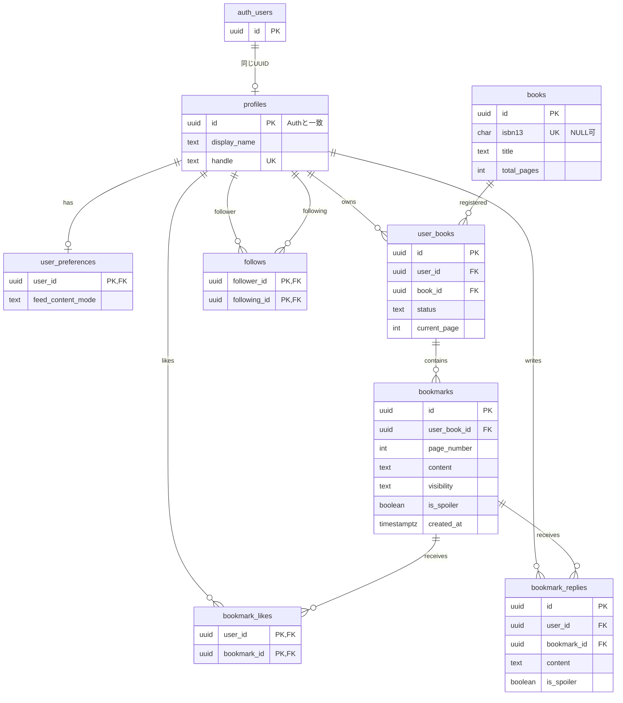

# DB設計書 — Supabase PostgreSQL + Drizzle

> v0.1 / 2026-10-31。論理設計の正本は `apps/api/src/db/schema/` とDrizzle migrations。SQLは設計例で、環境に合わせてマイグレーション化する。

## 1. 設計方針

- ユーザー認証はSupabase Authの `auth.users`。アプリ側プロフィールは `public.profiles` と別管理し、IDを一致させる。
- **ISBNがある本はISBN-13で重複排除**。ISBNのない本は `isbn13=NULL` とし重複を許容。主キーはUUID。
- **本棚 `user_books` は私有データ**。公開範囲は`bookmarks.visibility` に持たせる。公開本棚機能は作らない。
- 栞は「ユーザー×本」の `user_books.id` に所属。栞の流れは**投稿日時ASC**で取得。`page_number` は並び順に使わない。
- 投稿時刻はDB作成後変更しない。編集は `updated_at` を変更する。
- 削除した投稿と返信は `deleted_at` による論理削除。フィード・プロフィール・詳細から非表示。
- 公開・非公開とネタバレは別属性。ネタバレはUIにおける初期表示制御であり、秘匿は `visibility` の認可が担当する。

## 2. ER図



`auth_users` は図上の別名であり、物理テーブルはSupabase管理の **`auth.users`**。それ以外は原則 `public` スキーマ。

## 3. カラム定義

### `profiles`

| カラム | 型・制約 | 説明 |
|---|---|---|
| `id` | UUID PK | `auth.users.id` と共通。可能ならFK + ON DELETE CASCADE |
| `handle` | TEXT UNIQUE NULL | 任意の短いID。NULL複数可。文字種・長さはアプリで検証 |
| `display_name` | VARCHAR(50) NOT NULL | 初期値はゲスト表示名 |
| `bio` | TEXT NULL | 自己紹介、最大500文字[暫定] |
| `avatar_url` | TEXT NULL | 初期はなし、将来拡張 |
| `created_at` | TIMESTAMPTZ NOT NULL DEFAULT now() | 作成日 |
| `updated_at` | TIMESTAMPTZ NOT NULL DEFAULT now() | 更新日 |

### `books`

| カラム | 型・制約 | 説明 |
|---|---|---|
| `id` | UUID PK DEFAULT gen_random_uuid() | 内部ID |
| `isbn13` | VARCHAR(13) UNIQUE NULL | 取得できた場合のみ、正規化し検証 |
| `title` | TEXT NOT NULL | タイトル |
| `author` | TEXT NULL | 著者名 |
| `publisher` | TEXT NULL | 出版社 |
| `total_pages` | INT NULL CHECK (>0) | 外部APIの数値または手動入力 |
| `cover_url` | TEXT NULL | 利用可能な書影URL |
| `source` | TEXT NOT NULL | `google_books` / `openbd` / `manual` |
| `source_id` | TEXT NULL | 元API識別子 |
| `created_by_user_id` | UUID NULL FK profiles | 手動作成時の作成者、任意 |
| `created_at` | TIMESTAMPTZ NOT NULL | 作成日 |

- `UNIQUE (isbn13)` でもNULL行は複数保存できる。ISBNなしの自動統合はしない。
- 本が違う版なら別ISBN・別 `books.id`。作品単位の `works` は後から追加する。
- API取得データに書影がない／ページ数がないことを許容する。

### `user_books`

| カラム | 型・制約 | 説明 |
|---|---|---|
| `id` | UUID PK | ユーザー×本のレコード |
| `user_id` | UUID NOT NULL FK profiles | 所有者 |
| `book_id` | UUID NOT NULL FK books | 書籍 |
| `status` | TEXT NOT NULL | `want_to_read` / `reading` / `completed` |
| `current_page` | INT NULL CHECK (>=0) | 現在の読書進捗 |
| `created_at` | TIMESTAMPTZ NOT NULL | 登録日時 |
| `updated_at` | TIMESTAMPTZ NOT NULL | 更新日時 |

**UNIQUE (`user_id`, `book_id`)**。本棚に同じ本は1件だけ。読み返しを別に残したければ後で `reading_sessions` を追加する。`user_books` 自体に公開範囲は持たせない。

### `bookmarks`

| カラム | 型・制約 | 説明 |
|---|---|---|
| `id` | UUID PK | 栞ID |
| `user_book_id` | UUID NOT NULL FK user_books | 所属する本棚レコード |
| `page_number` | INT NULL CHECK (>0) | 栞を挟んだページ、任意 |
| `content` | TEXT NOT NULL | 最大2,000文字[暫定]、空白のみ禁止はAPIで検証 |
| `visibility` | TEXT NOT NULL DEFAULT 'private' | `public` / `private` をCHECKで保証 |
| `is_spoiler` | BOOLEAN NOT NULL DEFAULT false | ネタバレ指定 |
| `created_at` | TIMESTAMPTZ NOT NULL DEFAULT now() | **並び順の基準・変更しない** |
| `updated_at` | TIMESTAMPTZ NOT NULL DEFAULT now() | 編集日時 |
| `deleted_at` | TIMESTAMPTZ NULL | 削除済みか否か |

`bookmarks` に `user_id` を複製しない（初期段階）。投稿者は `user_books.user_id` をJOINする。フォロー中フィードが重くなった場合だけ `author_id` の非正規化を検討し、一致をDB制約で保証する。

### `follows`

| カラム | 型・制約 | 説明 |
|---|---|---|
| `follower_id` | UUID NOT NULL FK profiles | フォローする人 |
| `following_id` | UUID NOT NULL FK profiles | フォローされる人 |
| `created_at` | TIMESTAMPTZ NOT NULL DEFAULT now() | 作成日時 |

**PK (`follower_id`, `following_id`)**、`CHECK(follower_id <> following_id)`。対象が正式ユーザーであることの制御はAPI側で行う。

### `bookmark_likes`

| カラム | 型・制約 | 説明 |
|---|---|---|
| `user_id` | UUID NOT NULL FK profiles | いいねした人 |
| `bookmark_id` | UUID NOT NULL FK bookmarks | 対象 |
| `created_at` | TIMESTAMPTZ NOT NULL DEFAULT now() | 日時 |

**PK (`user_id`, `bookmark_id`)**。冪等PUT／DELETEを使う。いいね総数は初期段階では集計で取得し、キャッシュカウンタ列は設けない。

### `bookmark_replies`

| カラム | 型・制約 | 説明 |
|---|---|---|
| `id` | UUID PK | 返信ID |
| `bookmark_id` | UUID NOT NULL FK bookmarks | 元の栞（1階層） |
| `user_id` | UUID NOT NULL FK profiles | 投稿者 |
| `content` | TEXT NOT NULL | 最大1,000文字[暫定] |
| `is_spoiler` | BOOLEAN NOT NULL DEFAULT false | 返信にもネタバレを設定可 |
| `created_at` | TIMESTAMPTZ NOT NULL DEFAULT now() | 日時 |
| `updated_at` | TIMESTAMPTZ NOT NULL DEFAULT now() | 更新日時 |
| `deleted_at` | TIMESTAMPTZ NULL | 論理削除 |

`parent_reply_id` は作らない。返信への返信はMVP対象外。元栞が非公開／削除になったら第三者には返信一覧も返さない。

### `user_preferences`

| カラム | 型・制約 | 説明 |
|---|---|---|
| `user_id` | UUID PK FK profiles | 利用者 |
| `feed_content_mode` | TEXT NOT NULL DEFAULT 'tap' | `all` / `tap`、CHECK |
| `updated_at` | TIMESTAMPTZ NOT NULL DEFAULT now() | 更新日時 |

未ログイン利用者はローカル設定で代用可。登録済み／匿名にはDB保存。**閲覧者の設定であり、投稿や公開範囲の属性ではない**。

## 4. 制約・削除戦略

- `profiles.id` はSupabase AuthのUIDと一致させ、`PUT /me` で生成。Authユーザーの削除時にアプリデータをどう消すかは別途運用手順を用意。
- `user_books` に栞がある状態で本棚レコードを削除すると栞が失われるため、**DELETEを409で拒否**する。栞を削除後に削除する。[暫定]
- `bookmarks` の論理削除後も `bookmark_likes` と `bookmark_replies` は内部に残るが、APIで参照されない。長期保持方針は後で決める。
- 書籍レコードは複数ユーザーで共有するので、本棚から外した際に `books` 自体は削除しない。
- `visibility` と `status` などはDB `CHECK`、参照整合性はFK、重複は`UNIQUE`で保証。サービスコードだけに頼らない。
- 初期はDBに管理者権限の接続を使わず、アプリ専用の権限を与えたユーザーで接続する。

## 5. 最初に作るインデックス

```sql
-- 同じユーザーの同じ本は1つ（UNIQUE制約がインデックスも作る）
CREATE UNIQUE INDEX ux_user_books_user_book
  ON user_books(user_id, book_id);

-- すべての公開投稿を新しい順に取り出す
CREATE INDEX idx_bookmarks_public_feed
  ON bookmarks(created_at DESC, id DESC)
  WHERE visibility = 'public' AND deleted_at IS NULL;

-- 栞の流れは user_book_id で絞り、投稿の古い順
CREATE INDEX idx_bookmarks_flow
  ON bookmarks(user_book_id, created_at ASC, id ASC)
  WHERE deleted_at IS NULL;

-- フォロー先の投稿者からアクセスするクエリ向け
CREATE INDEX idx_follows_following ON follows(following_id);

-- 投稿単位の集計
CREATE INDEX idx_likes_bookmark ON bookmark_likes(bookmark_id);
CREATE INDEX idx_replies_bookmark_created
  ON bookmark_replies(bookmark_id, created_at ASC, id ASC)
  WHERE deleted_at IS NULL;
```

**注意**：`user_books(user_id,book_id)` のUNIQUE制約と同じインデックスを二重作成しない。上記はDDLの設計例。Drizzleで `uniqueIndex` として定義した場合は別の `CREATE UNIQUE INDEX` は不要。

必要になったら追加：

```sql
CREATE INDEX idx_bookmarks_public_flow
  ON bookmarks(user_book_id, created_at ASC, id ASC)
  WHERE visibility = 'public' AND deleted_at IS NULL;
```

公開栞だけを見る画面が重くなった場合にEXPLAINで検証して採用。

## 6. 重要なクエリ設計

### 6.1 栞の流れ（そのユーザー×その本）

1. `SELECT id FROM user_books WHERE user_id=$1 AND book_id=$2`（UNIQUEインデックスで高速に1件特定）。
2. 自分なら `WHERE user_book_id=$1 AND deleted_at IS NULL`、他人なら `AND visibility='public'`。
3. **`ORDER BY created_at ASC, id ASC LIMIT 16`**。カーソルありなら `(created_at,id) > ($2,$3)`。
4. 15件のIDを使っていいね／返信を一括集計。自分のいいね状態も一括取得。ユーザー・本は一覧の上位に1回だけ返す。

```sql
SELECT id, page_number, content, visibility, is_spoiler, created_at
FROM bookmarks
WHERE user_book_id = $1
  AND deleted_at IS NULL
  -- 他人の閲覧ならさらに AND visibility = 'public'
  AND (created_at, id) > ($2, $3) -- 2回目以降のときだけ
ORDER BY created_at ASC, id ASC
LIMIT 16;
```

初回はカーソル句を付けずに実行。`created_at` は不変。ページ番号が戻っても順序は変わらない。

### 6.2 全体フィード

```sql
SELECT id, created_at
FROM bookmarks
WHERE visibility = 'public'
  AND deleted_at IS NULL
  -- 続きを読むときだけ AND (created_at, id) < ($1, $2)
ORDER BY created_at DESC, id DESC
LIMIT 16;
```

**まず15件を確定**し、`JOIN user_books, profiles, books` や件数集計を**その15件に対して実施**。投稿全体を集計したり、1件ずつ取得したりしない。

いいね数と返信数を同じFROM句で無条件にJOINすると `likes × replies` の行が生成され得るため、事前集計したサブクエリを使う／別クエリで投稿ID集合に対して集計する。

### 6.3 フォロー中フィード

`follows.follower_id` を現在のUIDとしてJOIN→ `following_id = user_books.user_id` →そのユーザーの公開栞を新しい順に取得。初期は**Fan-out on Read**。大量のフォロー・投稿で遅くなったら `EXPLAIN (ANALYZE, BUFFERS)` で要因を確認し、必要時だけ `bookmarks.author_id` を追加する。

### 6.4 他人の公開本一覧

```sql
SELECT b.id, b.title, b.cover_url
FROM user_books ub
JOIN books b ON b.id = ub.book_id
WHERE ub.user_id = $1
  AND EXISTS (
    SELECT 1 FROM bookmarks bm
    WHERE bm.user_book_id = ub.id
      AND bm.visibility = 'public'
      AND bm.deleted_at IS NULL
  )
ORDER BY ub.created_at DESC, ub.id DESC
LIMIT 16;
```

公開栞がない登録本を公開しない。プロフィール一覧では栞本文は取得しない。

## 7. セキュリティとRLS

- アプリのテーブルへは原則 **Hono API → Drizzle → PostgreSQL** のみでアクセス。
- Supabase Data APIでブラウザから直接テーブルを読み書きできる状態にはしない（公開対象スキーマ・テーブル権限を明確に管理し、必要なRLSも設定）。
- **Hyperdrive経由のPostgres接続はSupabase Auth利用者のJWT文脈を自動では付与しない。** RLSだけに頼らず、Hono側で全読み取り／書き込みの認可条件を実装する。
- 非公開栞の閲覧判定は `user_books.user_id = jwt.sub` で行う。バックエンドのDBユーザーは最小権限を使用。
- マイグレーション専用の高権限接続と通常API接続を分離する。
- JWTやAuth/DBキーをログ／クライアントに露出させない。

## 8. マイグレーションと整合性

1. `schema.ts` にDrizzleでテーブル・列・制約・インデックスを宣言。
2. Drizzle KitでSQLマイグレーションを生成し、レビュー後に適用。
3. `schema.ts`・マイグレーション・DB設計書を同じPRで更新。
4. 外部キー／CHECK／UNIQUEとAPIバリデーションの両方をテスト。
5. タイムライン・栞の流れはテストデータ（特に同一日時・ページ逆順・非公開混在）で順序と認可を確認。

## 9. 将来拡張の余地

- `works` で作品単位のまとめ（ISBNが異なる版・翻訳等）。MVP外。
- `reading_sessions` で再読の回ごとの栞を分離。MVP外。
- `book_lists`, `book_list_items` で書籍リスト。MVP外。
- `bookmark_reposts` で内部リポスト。MVP外。
- 集計カウンタ／非正規化投稿者列／専門検索インデックス／推薦用ベクトルは**実測で必要になってから**。
